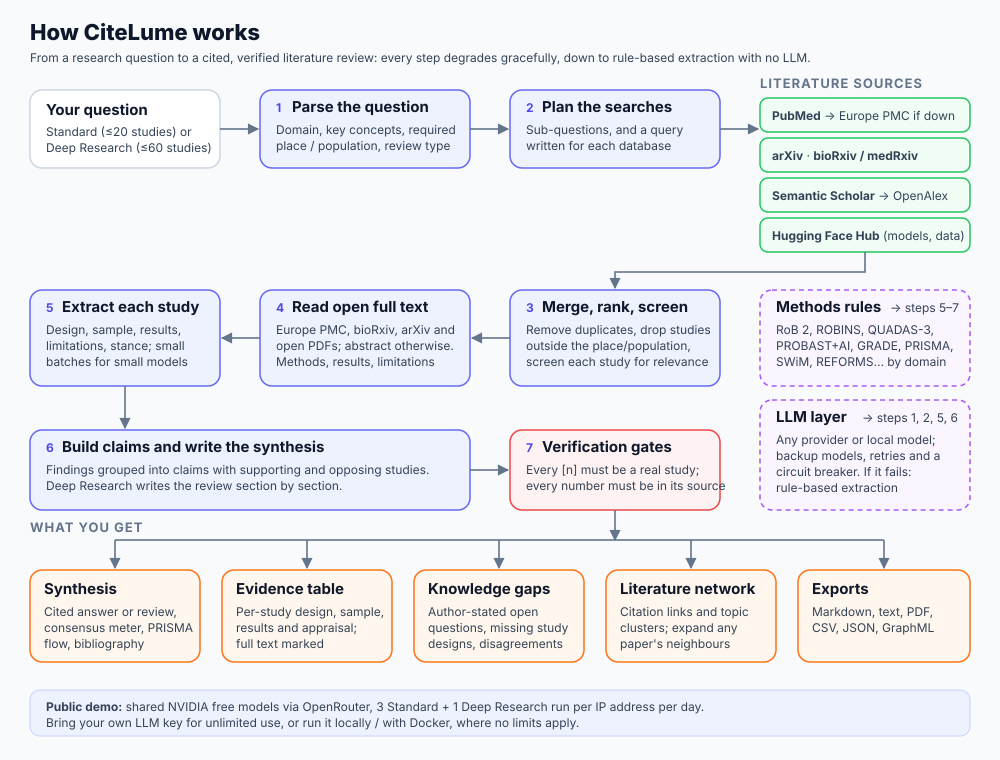

# CiteLume

An open-source literature review assistant. Ask a research question and it splits it into its main concepts and
aspects, runs a search for each on PubMed, Europe PMC, arXiv, bioRxiv/medRxiv and Semantic Scholar/OpenAlex, and
ranks what it finds. It then reads open-access full text where it is available, and produces:

- **A cited synthesis.** Choose a **Standard** answer from up to 20 studies, or a **Deep Research** review from up to
  60 studies. Deep reviews can be narrative, PRISMA-informed systematic or scoping, organised thematically,
  chronologically, methodologically or theoretically.
- **An evidence table.** It gives design, sample, results, limitations and a framework-informed appraisal for each study.
  Appraisal frameworks include RoB 2, ROBINS-I/E, QUADAS-3, PROBAST+AI, SYRCLE and REFORMS. See
  [docs/FRAMEWORKS.md](docs/FRAMEWORKS.md).
- **A knowledge-gap matrix.** Gaps come from the retrieved studies themselves:
  - open questions the authors state;
  - what the mix of study designs leaves out;
  - disagreements between studies;
  - thin areas of a question-specific evidence grid.
- **A literature network** with citation links and topic clusters.
- **A transparent choice of studies.** The 20 or 60 included studies are picked by fixed, published rules: eligibility
  checks, a 100-point score (relevance, study type, citations, recency, search agreement) and balanced selection
  across the aspects of the question. Every result shows the counts at each step and each study's score. See
  [docs/RANKING.md](docs/RANKING.md).
- **Exports** to Markdown, plain text, PDF, CSV, JSON and GraphML.



Every claim carries inline citations, and deterministic checks verify citation numbers and figures against the
source text. The tool works with any LLM provider, including small local models through Ollama. A larger model gives
fuller answers. Without any LLM, it falls back to rule-based extraction.

> Automated reviews are a starting point, not a substitute for a registered systematic review with dual independent
> screening. Always check the cited sources.

## Try it

- **Live demo:** https://citelume-976737283006.us-central1.run.app. You get 3 Standard and 1 Deep Research run per
  day for free, using NVIDIA's free models via OpenRouter. Add your own LLM API key in **⚙ API Keys & Sources Setup**
  for unlimited use. Your key is sent with each search and is not stored. The demo sleeps when idle, so the first
  visit can take a few seconds.
- **Run it yourself:** see below. No limits apply, and you can use any provider or a local model.

## Run locally

Requirements: Python 3.10+ and Node.js 18+.

```bash
git clone https://github.com/mbsai/citelume.git
cd citelume
python3 -m venv .venv && .venv/bin/pip install -r backend/requirements.txt
./start.sh
```

Open http://127.0.0.1:8000, then click **⚙ API Keys & Sources Setup** and choose an LLM provider. Supported providers
are OpenRouter, OpenAI, Anthropic, Google Gemini, Hugging Face, Ollama and any OpenAI-compatible server.

The literature sources work without keys, but some free keys make them more reliable:
- an [NCBI key](https://www.ncbi.nlm.nih.gov/account/) for PubMed;
- a [Semantic Scholar key](https://www.semanticscholar.org/product/api);
- an [OpenAlex key](https://openalex.org/settings/api).

### With Docker

```bash
docker build -t citelume .
docker run -p 7860:7860 citelume
```

Then open http://127.0.0.1:7860.

## Hosting your own public demo

Demo mode is controlled by environment variables. See [.env.example](.env.example). Demo mode:

- limits each IP address per UTC day: 3 Standard and 1 Deep Research run by default. IPv6 visitors are counted per
  /64 network, so rotating addresses don't reset the allowance;
- restricts the shared key to NVIDIA's free models on OpenRouter;
- does not count visitors who bring their own key against the limits;
- blocks local model servers so the host's network cannot be reached.

**Google Cloud Run** (scales to zero, so a small demo usually stays within the free allowance):

1. Create a project with billing, and store the shared OpenRouter key as the secret `demo-openrouter-key`.
2. Run `PROJECT=<your-project> ./deploy/cloudrun.sh`.

The script runs one instance at most, keeps the daily counts in a Cloud Storage bucket so they survive restarts, and
allows 30-minute requests for Deep Research.

The same Docker image also runs on Hugging Face Spaces (a paid plan is now needed for Docker Spaces) or on any Docker host.

## Tests

```bash
cd backend && python -m unittest discover -s tests
```

## Licence

MIT. See [LICENSE](LICENSE).
